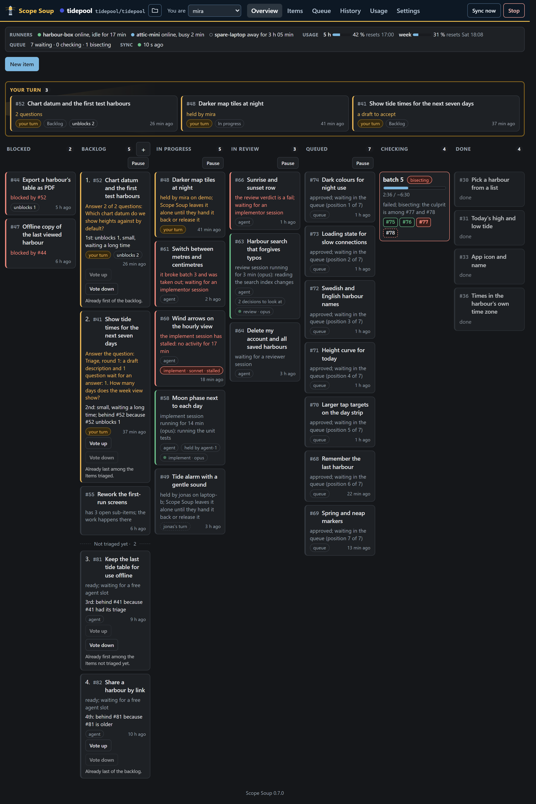
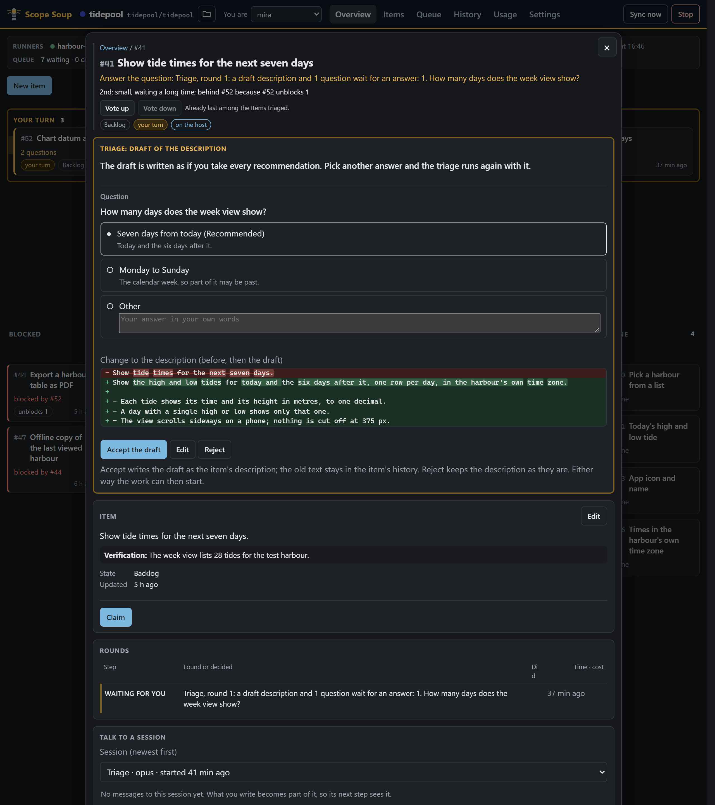
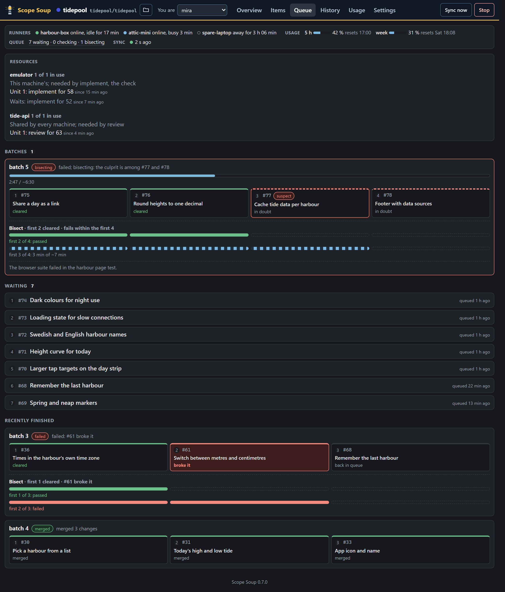
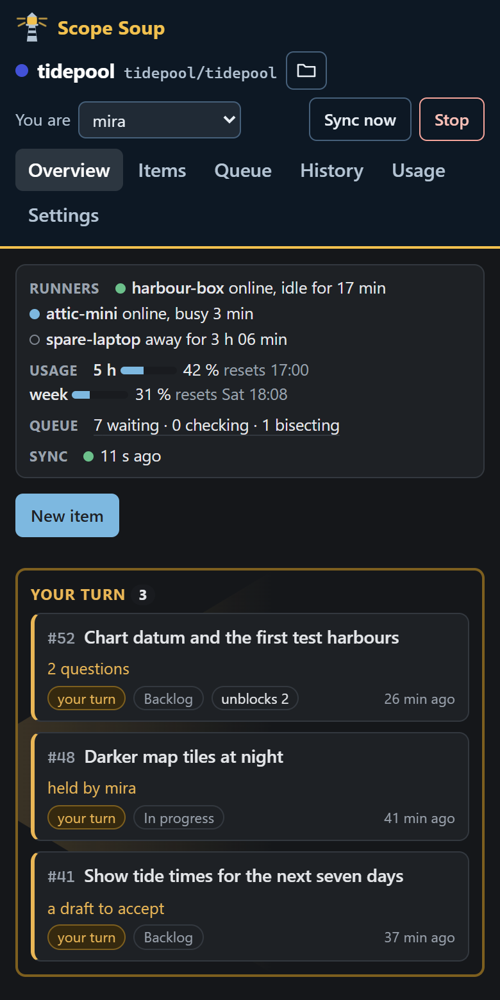

# Scope Soup

Scope Soup is a program with a web board that works a project's backlog with coding agents. It saves a person's attention for what only a person can decide.

**Status: early, and changing fast.** See [What works today](#what-works-today).



## Why

Claude has made writing code fast. What slows a project down now is what surrounds the code:

1. **The project stops.** A Claude Code session works until it is done or has a question, and then everything waits for you. Scope Soup is a program, not a chat. It starts the next step and the next Item, and when one Item needs you, only that Item waits.
2. **Your attention.** Reading what the agents did, answering their questions, deciding what comes next. Scope Soup brings you questions with what was tried, the options and a recommendation, and lists only what waits for you.
3. **The check.** Changes now arrive faster than a check can test them one at a time. Scope Soup tests reviewed changes in batches on top of the newest main, and bisects a failed batch.

## Why not an existing tool

We looked ([`docs/research/`](docs/research/)). Each of these does part of it well:

| Tool | Does well | Leaves out |
|---|---|---|
| Claude Code's `/ship`, Claude Ship | One change to a reviewed pull request, then fixing its checks and comments | A backlog, triage, a merge queue; one pull request per session ([`ship-command.md`](docs/research/ship-command.md)) |
| OpenAI Symphony | The orchestrator as a program, per-issue workspaces | Review, merging, a usage budget, a real board; built around one tracker |
| Gas Town | A whole crew of agents with a merge step | AI sessions supervise and merge, which users report as fragile and costly |
| Mergify, Trunk, Zuul | Batching queues with bisect and good queue views | Work items, agents, whose turn it is |
| GitKraken Launchpad | One list across hosts | Batches, agents, anything that acts |

## How it works

You follow one thing, the **Item**. It holds the description, the change and its diff, the review verdicts, the check results, the agent sessions and a log in plain words.



An Item travels like this:

1. **Triage.** An agent reads it: is it ready, how big is it, does it hide a decision? It may propose a rewritten description or a restructuring (split it, fold a part into another Item, or close it as a duplicate), for you to accept, edit or reject. Triage, the implementor and the reviewer may also propose separate work they found; each proposal is a draft Item that waits for your Approve or Deny, and nothing is filed before.
2. **Implement.** An agent works on the Item's own branch in a workspace of its own. A person, or your Claude Code session, can take the Item instead and hand a branch back (`scopesoup item`).
3. **Review.** A second agent reviews. Findings go back to the implementor.
4. **Merge queue.** The check passes on exactly the commit that is pushed. Fast-forward, never forced.

You choose how much to hand over, one level at a time:

| Level | Name | What Scope Soup does |
|---|---|---|
| 0 | Watch | Only shows the work. |
| 1 | Triage | Reads every Item. |
| 2 | Implement | Also builds Items. |
| 3 | Review | Also reviews them. |
| 4 | Autopilot | Also merges, through the batching queue. |

The level limits only what Scope Soup does on its own: a person can still pick an Item's state at any level. At levels 2 and 3 the implementing agent merges the way your `CLAUDE.md` says, or opens a pull request. Nothing runs until you press Resume on the lanes of the overview (triage on Backlog, implementors on In progress, review on In review, the merge queue on Merge queue).



Items live in your repository (a text file and an append-only log per Item, on a branch) or are your existing GitHub Issues or Jira issues, read live. Settings' "Connect to GitHub Issues" and "Connect to Jira" switch later and move the Items you tick; "Move back to the meta branch" returns them. An optional label (`labels.aiGenerated`) marks Items an AI made or rewrote.

## What works today

Early, and changing fast. Runs for real are in [`docs/TRIALS.md`](docs/TRIALS.md).

- **Built and run for real**, on a stand-in project: the triage, implement and review loop with questions answered on the Item page; merging after a check, including a failed check; the batching queue with flake rerun and bisect; Items in your repository; the Usage page and the History timeline; images agents attach to an Item; the Item's diff in your own diff tool; `scopesoup item` for people and Claude Code sessions; Windows sessions that start and stop cleanly.
- **Built and tested, not yet run on a real project:** most of the board, GitHub Copilot CLI as an agent provider, GitHub Issues as the backlog, waiting for CI on GitHub, several people on one project, usage forecasting against your Claude subscription, the onboarding plugin, offboarding, releases and updates; triage's restructurings and agents' Item drafts; singleplayer; connecting to GitHub Issues or Jira later and moving back to the meta branch; Jira, Cloud and Data Center, reads and writes (untried on a real site).
- **Also built and tested:** the Item page's State menu (a person's pick at any level, with Undo; picks for another machine's work go through the meta branch), Abandon and Reopen, Settings that saves at once, Implement anyway over triage's verdict, an implementor model per size, and "Open the board" in the onboarded repository's `CLAUDE.md` and `README.md`.
- **Planned:** see the issues.



## Install and run

You need:

- **Windows 11.** That is where it is built and tried. It is plain Node and git, so macOS and Linux may work, but nobody has tried them.
- **Claude Code** (the `claude` command), signed in with a Claude subscription. Agents run through it.
- **Node 22.18 or newer**, **git** and **pnpm**. Or, on Windows without Node: run `scopesoup-<version>-win-x64.exe` from a release, which sets Scope Soup up with its own Node (no admin rights; [`docs/RUNNING.md`](docs/RUNNING.md), "Installing and upgrading").
- For a GitHub project: a token that can read the repository (and write, if Scope Soup should comment on and close issues).

Try the board on made-up data:

```
pnpm install
pnpm web:build
pnpm demo          # http://127.0.0.1:4310
```

To put a project under Scope Soup, use the Claude Code plugin in a session in that project:

```
/plugin marketplace add mikaeltulldahl/scopesoup
/plugin install scopesoup@scopesoup
/scopesoup:scopesoup-onboard
```

It asks three things, shows one summary and acts on one yes (and can add a Start menu shortcut, "Scope Soup – <project>", that starts Scope Soup and opens the board; by hand: `scopesoup shortcut`, `scopesoup open`). The project starts at level 0, where nothing runs. You raise the level on the board's Settings page. To join a project that already runs Scope Soup, run the same skill in your own clone. See [`docs/ONBOARDING.md`](docs/ONBOARDING.md) and [`docs/RUNNING.md`](docs/RUNNING.md). Leaving is as easy: `/scopesoup:scopesoup-offboard` lists what it created and removes what you do not keep.

## Where the data lives

- **Origin is the source of truth:** the main branch, the Item branches and the Items (on the ref `refs/scopesoup/meta`, or as GitHub Issues or Jira issues). Alone on a project (singleplayer, set on the Settings page) you can keep the meta ref in your clone and push nothing under `refs/scopesoup/`.
- **Scope Soup never works in your clone.** It keeps its own clones and makes a work clone per Item. Claude Code sessions touch only their Item's work clone.
- **A local SQLite file** caches what it read and holds its event log. Deleting it loses nothing about an Item.
- No login. The board listens on this machine only.

Details: [`docs/DESIGN.md`](docs/DESIGN.md).

## Safety rules

Enforced in code from day one:

- Agents never touch real data or production.
- Nothing irreversible happens without a person.
- One switch stops everything.
- Every action is logged in a log that cannot be edited.
- Decisions that belong to a person are put to that person.

Everything else is the level or a setting ([`docs/RULES.md`](docs/RULES.md)).

## Reading on

- [`docs/DECISIONS.md`](docs/DECISIONS.md): what is decided, and the direction.
- [`docs/RULES.md`](docs/RULES.md), [`docs/PEOPLE.md`](docs/PEOPLE.md): the rules, levels and people.
- [`docs/DESIGN.md`](docs/DESIGN.md), [`docs/RUNNING.md`](docs/RUNNING.md), [`docs/ONBOARDING.md`](docs/ONBOARDING.md), [`docs/github-mapping.md`](docs/github-mapping.md), [`docs/BATCH_SIZE.md`](docs/BATCH_SIZE.md).
- [`docs/research/`](docs/research/): the tools we looked at first.

Working on Scope Soup itself: `pnpm check` and [`CLAUDE.md`](CLAUDE.md).

## License

MIT ([`LICENSE`](LICENSE)).
