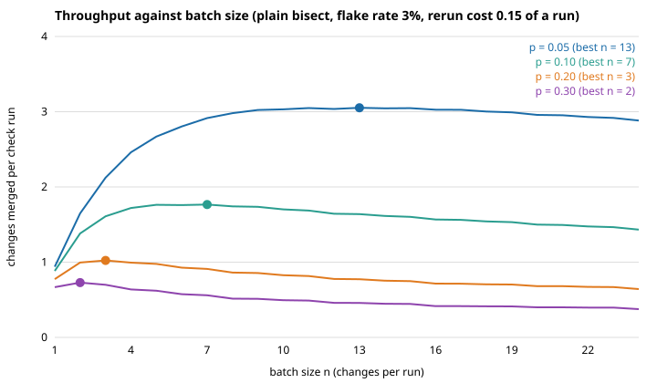
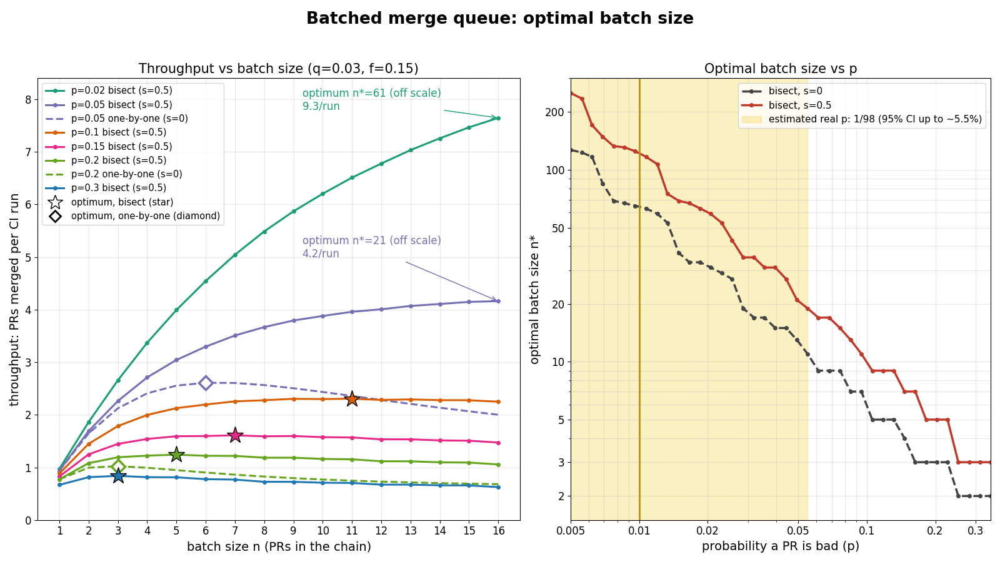

# Batch size for the merge queue

How many ready changes the queue should test in one chain, and why `n = clamp(round(c / p), min, max)`. This page states the model, checks it against `src/queue/sizing.ts`, and says how Scope Soup adjusts the size from measured rates. The numbers below come from the exact model, evaluated here and checked against a Monte Carlo run of a 20,000-change queue.

## The model

A batch stacks `n` ready changes into a chain `main -> c1 -> ... -> cn`. One check run tests one chain commit, so it tests a prefix.

1. Run prefix `n`. Green: all `n` merge.
2. Red: rerun only the failed test files on the same commit. A flake (probability `q` per run, independent of the changes) is cleared by this.
3. Still red: bisect for the first bad change `k` (prefix `k-1` green, prefix `k` red). Every green prefix found on the way merges at once.
4. Change `k` is sent back. Changes `k+1..n` return to the queue and are tested in a later batch.

Optional variant: with probability `s` the failure report names the culprit directly (the log-to-change mapping). Then prefix `k-1` is tested first; green means `k` is confirmed.

Assumptions: each change is bad independently with probability `p`; the queue always holds enough changes to fill a batch; a full run costs 1; a red run costs an extra `f` (the rerun of the failed files, `f = 0.15` of a run); `q = 0.03`. The culprit's own batch does not count it as merged.

## The math

**Merged per batch.** Change `j` merges if it and everything before it are good, so

```
E[merged] = sum_{j=1..n} (1-p)^j = (1-p) (1 - (1-p)^n) / p
```

This grows with `n` but saturates at `(1-p)/p`: more changes in the chain only help while the chain is likely to be mostly green.

**Cost per batch.** One run, plus on failure (probability `1 - (1-p)^n`) the flake check and about `ceil(log2 n)` bisect runs:

```
E[cost] ~ 1 + (1 - (1-p)^n) * (f + ceil(log2 n)) + (1-p)^n * f * q
```

**Throughput** is `E[merged] / E[cost]`, merged changes per check run. The exact version evaluates (the real bisect path for every `k`, flakes on every run, including bisect runs); the Monte Carlo run agreed with it within 1.6%. The closed form above is within about 6% of the exact one and gives the same optimum to within one or two.

**The optimum.** For small `p`, `1 - (1-p)^n ~ np`. Below `n ~ 1/p` a batch almost always passes and the cost is about one run, so a larger `n` is nearly free. Above it a batch usually fails, bisection costs `log2 n` runs, and merged changes saturate. The two effects balance near `n* = c / p`:

- `c ~ 0.7` with plain bisect (`s = 0`).
- `c ~ 1.0` when the failure report names the culprit often (`s = 0.5`), since the bisect shrinks to one or two runs.

The curve is flat at the top: throughput within 5% of the best holds for roughly `0.5 n*` to `2 n*` (for example `n` from 7 to 23 at `p = 0.05`). Missing the optimum by a factor of two costs little; picking `n = 1` or `n = 50` at the wrong `p` costs a lot.

## The result

Optimal `n` and throughput (changes merged per check run), `q = 0.03`, `f = 0.15`. In brackets: the range within 5% of the best.

| p | bisect, s=0 | 0.7/p | bisect, s=0.5 | no batching (n=1) |
|---|---|---|---|---|
| 0.02 | 31, 6.40 [17-65] | 35 | 61, 9.31 [29-129] | 0.97 |
| 0.05 | 13, 3.05 [7-23] | 14 | 21, 4.21 [12-47] | 0.94 |
| 0.10 | 7, 1.77 [4-11] | 7 | 11, 2.31 [6-21] | 0.88 |
| 0.15 | 4, 1.28 [3-7] | 5 | 7, 1.61 [4-13] | 0.83 |
| 0.20 | 3, 1.02 [2-5] | 3 | 5, 1.24 [3-9] | 0.77 |
| 0.30 | 2, 0.73 [2-3] | 2 | 3, 0.84 [2-5] | 0.67 |

Other results:

- Bisect with mapping merges 17% (`s=0`) to 60% (`s=0.5`) more per run than testing prefixes one by one at `p = 0.05`. At `p >= 0.2` they are about equal. Bisect was better at every `p` tried.
- Batching beats no batching by a wide margin whenever `p <= 0.1`, and is no better at `p = 0.3`.
- A failure rate of about 1% (`q` about 1 to 2%) puts the unbounded optimum at 60 or more, so the cap decides. A project whose CI is the first place a full browser suite runs can expect `p` of 5 to 15%.
- The recommended rule: `n = clamp(round(c / p_hat), 2, 12)` with `p_hat` the failure rate over the last 30 outcomes, counting only failures that survive the flake rerun, floored at 0.03 so a quiet week does not make the queue greedy. The cap of 12 keeps chains short to build, keeps the wait to merge reasonable, and keeps conflicts rare.

The plot: `docs/images/batch-size.svg`, made from the exact model above (plain bisect, `p` = 0.05, 0.1, 0.2, 0.3, `n` = 1 to 24, the best `n` marked). Each curve rises steeply to its optimum and then declines slowly; the optimum moves left as `p` grows.



A second plot, with `s = 0.5` curves, the one-by-one comparison, and the optimum against `p` on the right (the shaded band is a failure rate of about 1% with its 95% confidence interval; "PRs" in its labels are changes):



## The simple rule

`src/queue/sizing.ts`, called from `src/queue/advance.ts`:

```
n = clamp(round(c / p), min, max)
p = max(pFloor, failures / outcomes over the last `window` outcomes)
```

with `defaultConfig.batch = { min: 2, max: 12, cBisect: 0.7, cMapping: 1.0, pFloor: 0.03, window: 30, minOutcomes: 10, model: true, rerunCost: 0.15 }`. This is the rule used until `minOutcomes` outcomes are known, and always when `model` is off. `c` is `cMapping` when the mapping is on and `cBisect` otherwise. It is adaptive in one signal: the culprit rate. A flake is not recorded as a failure. The default floor of 0.03 and cap of 12 mean it sits at 12 until `p_hat` exceeds about 0.08 (mapping on) or 0.06 (mapping off).

## How Scope Soup picks the size: the model on measured rates

`src/queue/sizing.ts` has the model as pure functions: `throughput(n, p, q, f, s)` is the exact model above (the real bisect path for every first bad change `k`, flakes on every run), and `bestSize(p, q, f, s, min, max)` takes the `n` in `[min, max]` with the highest throughput (the smallest wins a tie). `batchSize` is what the queue calls: with `batch.model` on and at least `batch.minOutcomes` (10) outcomes it uses the model; otherwise, or with `model` off, it uses `ruleSize`, the `round(c / p)` rule. At most `max - min + 1` evaluations per step.

| Input | Source |
|---|---|
| `p` | measured: culprit rate over the last `window` outcomes, floored at `pFloor` (as before) |
| `q` | measured: `counters.flakes / counters.runs`, over all runs so far (not windowed), capped at 0.5; 0.03 before any run |
| `s` | measured: of the batches that ended with a culprit while the mapping was on, the share in which the failure report pointed at that culprit (`state.measured.s`); mixed with 0.5 as if seen 4 times, so a few batches move it and one does not; 0 with the mapping off |
| `f` | measured: the time of a rerun over the time of the red full run it repeats (`state.measured.f`), mixed with `batch.rerunCost` (setting `queueRerunCost`) as if seen 4 times. With `rerunFilesCommand` a rerun takes only the failed files, so f falls; without it the whole check runs again and f measures about 1, which makes batches smaller |
| check duration | measured: the queue times every full run that ended green or red (`ms` on the run input). A line `d(m) = a + b m` is fitted through duration against the members the run covered, once there are 6 runs of at least two lengths and the line rises; the model then prices a run of prefix m by `d(m)` (`throughput`'s optional last argument). Before that every run counts as equal |
| queue depth | not used: a batch is cut to the changes that are ready anyway |

`measuredRates` in `src/queue/sizing.ts` turns the sums kept in the state into f, s and d. A timed-out run, or a pass that changed tracked files, is not timed. The board's Queue page shows what has been measured.

The limits and the starting numbers are settings (`queueMinBatch`, `queueMaxBatch`, `queueRerunCost`, `queueMinOutcomes`), read at every step; `batch.cBisect`, `cMapping`, `pFloor`, `window` and `model` stay the engine's defaults.

The tests (`src/queue/pure.test.ts`) check the table above (optimal `n` within 1 and throughput within 0.02 for `s = 0` and `s = 0.5`), `n = 1` against the no-batching column, that a higher `p` never gives a larger `n`, the bounds, the fallback, and that more flakes do not raise `n`. With the default cap of 12 and floor of 0.03 the model and the rule mostly agree; the model differs when `q` or `f` are not the defaults.

Open: whether to wait for a batch to fill. The rate `s` is the mapping's hit rate, which is a stand-in for how often the log names the culprit.

Measured on the stand-in with real sessions (`docs/TRIALS.md`, 2026-11-24, #10), too few samples to set defaults from:

| Value | Measured | Samples | Note |
|---|---|---|---|
| d(n) | about 20.2 s for every n from 1 to 8; fitted slope -4 ms per change | 12 timed runs, lengths 1, 4, 6, 7, 8 | A check dominated by one slow test; the line does not rise, so the model keeps counting runs as equal |
| f | 1.00 (mixed with the default: 0.51) | 3 reruns | No `rerunFilesCommand`, so each rerun is the whole check, as the table above expects |
| s | 0 of 2 (mixed: 0.33) | 2 culprit batches, one of them the same change checked twice (#40) | The failing files were other changes' tests; the culprit's file appeared only in the stack traces, which the mapping does not read |

Open as well: whether the mapping should read file names from stack traces, which would have named the culprit in both batches.
